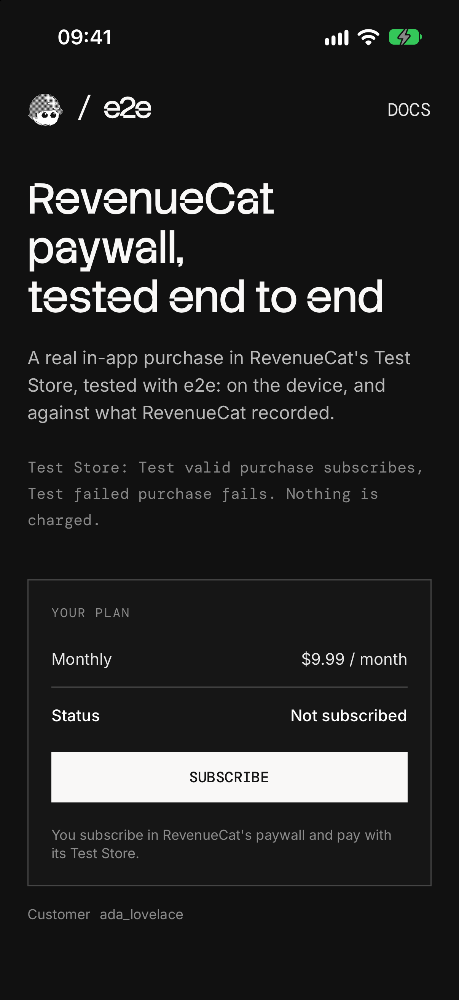

# e2e-revenuecat

An Expo app that makes real in-app purchases through RevenueCat's Test Store, used as an example of end-to-end testing a purchase flow you don't own, on iOS and Android, with [e2e](https://www.npmjs.com/package/e2e).



## How it works

The app uses RevenueCat's paywall, the flow RevenueCat recommends, and its Test Store, so no App Store Connect or Google Play setup is needed:

- **Plan screen** (`src/app/index.tsx`) shows the monthly plan from RevenueCat's current offering and a Subscribe button.
- **RevenueCat's paywall** (`RevenueCatUI.presentPaywall`) opens over the app as a native screen RevenueCat draws. Its Purchase button opens the **Test Store dialog**.
- **Back on the plan screen**, the app asks RevenueCat for the customer's entitlement instead of trusting the paywall's result, and shows Subscribed, or "Paywall closed. Nothing was charged."

A link signs in as a RevenueCat customer: `e2erevenuecat:///?customer=<id>`. The tests open it to start every test as a new customer, and a fresh install that opens it gets the subscription back. Without it, the app uses RevenueCat's anonymous id.

There is no backend: RevenueCat keeps the purchases. The SDK setup is in `src/lib/revenuecat.ts` and `src/hooks/use-subscription.ts`.

### Test Store

| Button in the dialog   | Result                                                                      |
| ---------------------- | --------------------------------------------------------------------------- |
| `Test valid purchase`  | Subscribed. A Test Store month lasts 5 minutes; it renews up to 5 times     |
| `Test failed purchase` | The purchase fails; Android shows the error, iOS returns to the paywall     |
| `Cancel`               | Back to the paywall                                                         |

Nothing is charged.

## Getting started

Use Node 22.22.3+, 24.8+, or 26+, with Xcode and an iOS simulator, or the Android SDK and an emulator ([Expo's setup guide](https://docs.expo.dev/get-started/set-up-your-environment/)).

```bash
npm install
npm run ios       # or: npm run android
```

This builds the app in Debug, installs it on the running simulator or emulator, and starts Metro. RevenueCat's paywall needs native code, so the app doesn't run in Expo Go, and a Test Store key stops a Release build on purpose. Rebuild after native changes (`app.json`, packages with native code); JavaScript changes load from Metro.

### RevenueCat key

Everything runs in a free RevenueCat project. Create one at [app.revenuecat.com](https://app.revenuecat.com): it comes with a Test Store and a sample catalog, a monthly, a yearly, and a lifetime product in a `default` offering, which the app uses as is. Copy `.env.example` to `.env.local` and set `EXPO_PUBLIC_REVENUECAT_API_KEY` to the Test Store key (`test_…`) from **Apps and providers → Test configuration**. Restart Metro with `npx expo start --clear` after changing it.

## End-to-end tests

The tests in `tests/paywall.e2e.ts` buy through RevenueCat's real paywall and Test Store dialog: a purchase, a failed purchase, cancelling, closing the paywall, and a fresh install that signs back in. They combine exact locators on the plan screen with `agent.act` / `agent.assert` steps on RevenueCat's screens, then check what RevenueCat recorded through its REST API v2. Each test signs in as a new customer through the app's link and deletes it afterwards. RevenueCat's screens aren't the app's own, so a failed test runs up to two more times. `tests/home.e2e.ts` uses locators only.

The tests read three more values from `.env.local`:

- `REVENUECAT_SECRET_API_KEY`: a V2 secret key (`sk_…`) from **Project settings → API keys**, with Customers read and write, Subscriptions read, and Products read. Give the demo a RevenueCat project of its own: a secret key reaches the whole project.
- `REVENUECAT_PROJECT_ID`: from **Project settings → General**.
- `AI_GATEWAY_API_KEY`: the agent model goes through the Vercel AI Gateway (or link a Vercel project).

With the app installed on the simulator or emulator, run:

```bash
npx e2e run --target ios
npx e2e run --target android
```

Without `--target`, both run. The runner starts Metro, or uses the one already running. Configuration lives in `e2e.config.ts`.

## Scripts

| Command             | Description                                          |
| ------------------- | ---------------------------------------------------- |
| `npm start`         | Start Metro                                          |
| `npm run ios`       | Build and run the Debug app on an iOS simulator      |
| `npm run android`   | Build and run the Debug app on an Android emulator   |
| `npm run lint`      | Run ESLint                                           |
| `npm run typecheck` | Type-check with TypeScript                           |
| `npm run test:e2e`  | Run the e2e tests                                    |
